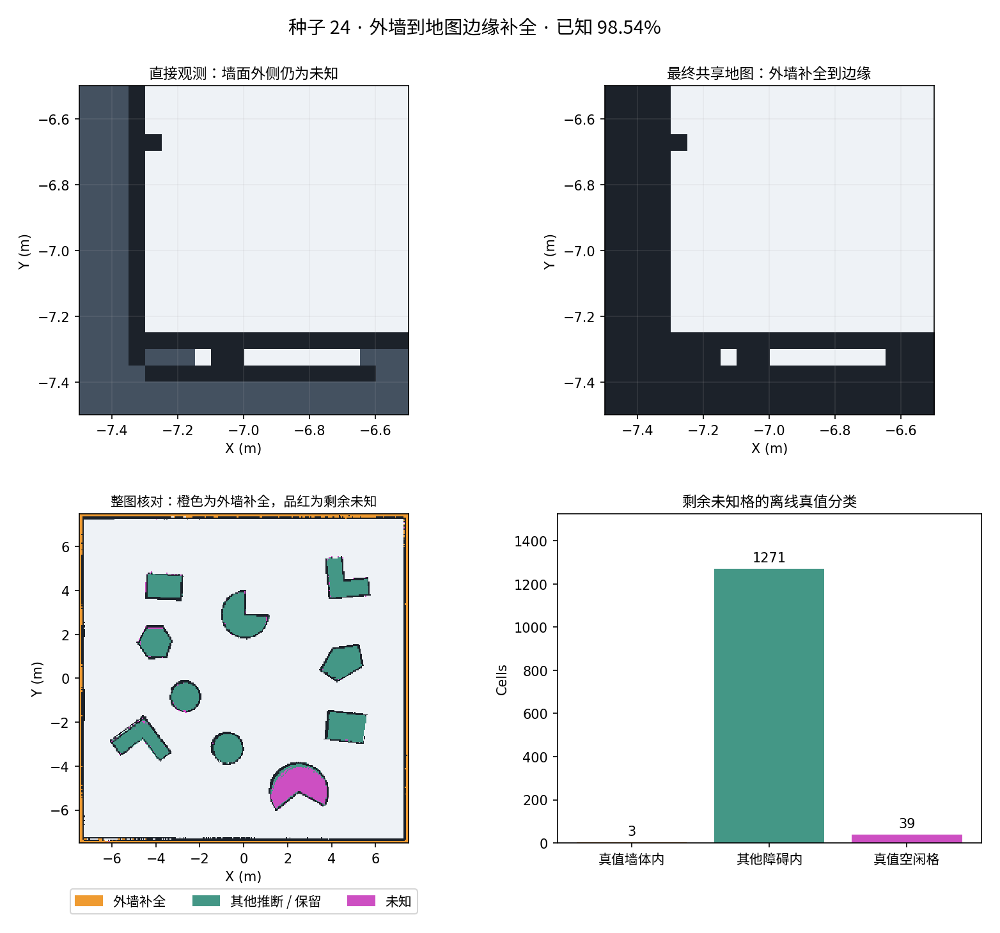

# 外墙到地图边缘补全（2026-10-27）

## 修复内容

针对“外围已探明墙面到地图边缘之间仍按未知统计”的问题，新增独立的外墙补全层。墙面向地图边缘的未知格经证据确认后，在 `/map` 中标成障碍，参与路径规划、地图已知比例和地图保存。

原来的紧凑实心障碍补全会跳过细长墙体，而且外沿未知带与地图边缘连通，不属于封闭内部孔洞，因此不会被填充。新规则单独处理这种情况，原始直接观测地图仍保留。

## 规则与边界

1. 使用实时 SLAM 的占据、空闲和辅助轮廓证据，地图边缘作为墙体外侧终止边界。**不读取随机场景真值、种子几何或真实墙厚。** 这是在本课程外围墙场景下使用的边界先验。
2. 仅在距边缘 **0.50 m** 以内寻找墙面；支持墙段连续至少 **0.75 m**，至少 **60%** 有强占据观测，深度变化不超过 **0.15 m**，朝场地内一侧存在空闲观测。
3. 从符合条件的墙面向外投影到地图边缘，不越过任何直接观测空闲格。最多连接 **0.15 m** 的未知栅格小裂缝；有两侧正交墙支持时，允许向拐角延伸至多 **0.30 m**，填两条墙带，保留内侧空闲角落。
4. 至少 **3 次新地图更新、持续 2 秒** 才确认。确认后沿用证据记忆，暂时失去轮廓不会到期清除；稳定的新空闲反证只撤回对应墙体格；修正一个墙面格不会清空整列墙体。
5. 内部普通障碍、没有墙面证据的边缘、门口大缺口不使用该规则。证据不足的小区域仍可能保持未知，不强制将显示改为 100%。

方法版本为 `persistent-obstacle-and-boundary-v6`。网页新增“其中外墙补全”分项，它已包含在障碍推断 / 证据保留比例内，不能再与总比例相加。保存结果新增：

- `boundary_obstacles.pgm / boundary_obstacles.yaml`：当前外墙推断格掩码。
- `mapping_evidence.json` 中的 `boundary_obstacle_cells`、`boundary_obstacle_fraction` 和边界规则参数。

原有 `observed_map`、`contour_evidence_map`、`inferred_obstacles` 和 `shared_map` 继续保存，可分别核对直接观测、全部推断和最终地图。

## 检查

- 两份工作空间均构建 5 个包成功，158 项 Python 测试通过。
- 新增 18 项外墙测试：四边和四角、四个方向的门口、未知大缺口、已观测空闲格、内部墙、短物体、弱轮廓、无证据边界、小裂缝、时间及新更新门槛、长期保留、稳定空闲反证撤回，以及 0.025 / 0.05 / 0.1 m 分辨率；另覆盖四个方向的墙面细调，确保保留仍有证据的外侧墙体，不产生一个发布周期的未知闪烁。
- 桥接生命周期残留节点 `0/9`，TF 锁回归通过。
- 用修改前保存的地图作一次空间核对：新增规则识别出 2603 个原本未知的墙体格，全部位于真值墙体内。这是同一已保存地图的离线核对，不是当前实跑的最终统计。
- Chromium 156 实际打开网页，“其中外墙补全”显示正常，无 JavaScript 错误。

## 正式仿真结果

正式验收目录为 `runs/boundary-walls24-stable-20261027/`：种子 24、默认配置，真实 ROS 2 / Gazebo 自主探索 480 秒后暂停保存。

| 指标 | 本轮结果 |
| --- | --- |
| 外墙补全并保存为障碍 | 3200 格，8.00 m²，占地图 3.56% |
| 最外侧一行 / 一列的剩余未知 | 0 格 |
| 距地图边缘 30 cm 内剩余未知 | 6 格 |
| 真值墙体内剩余未知 | 3 格 |
| 其他障碍内剩余未知 | 1271 格 |
| 真值空闲位置剩余未知 | 39 格 |
| 全图已知比例 | 98.54% = 直接观测 87.91% + 全部推断 / 保留 10.63% |
| 可达空闲区覆盖率 | 100%，三个分区分别为 100% |
| 最小静态外缘间隙 / 机器人外缘间距 | 0.1348 m / 3.0533 m |
| 地图重载 | Nav2 map_server 的 90000 格完全一致 |
| 退出与源码 | 启动器 0，无异常退出或残留；117 个运行源文件未变且与仓库源码一致 |

外墙补全层的所有格都在原始直接观测中为未知，并在共享地图中保存为 100；没有覆盖任何直接观测格。对照真值，有 13 格在墙面外，最远 2.5 cm，属于一格以内的边界误差；没有距真实墙体超过 15 cm 的补全。围墙外侧这圈已处理，剩余未知主要位于内部障碍，不能据此强行把总数改成 100%。



上图比较的是**同一时刻的直接观测层与最终共享地图**，不是两轮不同探索的速度比较。整图用橙色突出外墙补全，品红色突出剩余未知；右下分类仅用于独立真值核对，不向机器人提供真值。

稳定性检查分两个观察窗口，共 653 次地图更新。成熟占据格到未知的 1565 格次撤回集中在两个事件，与原有紧凑障碍内部空闲反证撤回记录同步；未发现额外无依据的成熟占据格丢失。开发中另修复了“单格墙面变化清掉整个投影列”的过度撤回；正式版按格撤回，未被反证的墙体保留。早期 `boundary-walls24-20261027`、`boundary-walls24-final-20261027` 是定位该问题的开发运行，不作为正式版验收结果。

证据摘要：[boundary-wall-evidence-20261027.json](boundary-wall-evidence-20261027.json)。本机正式运行保留完整日志、原始观测、外墙补全掩码、共享地图与 PBStream。被动观察器的首次窗口由人工 SIGINT 结束并保存统计，第二窗口随仿真关闭自然退出，不属于仿真子进程异常。

## 使用

```bash
cd /home/bwz/turtlebot_fleet_ws
./run.sh --seed 24
```

打开 `http://127.0.0.1:8765`，三车就绪后开始探索。更新后需重新启动一次，已结束且没有保存地图的旧进程无法事后重建。希望保留具体格图供核对时，请在退出前保存地图与运行结果。仅通过网页操作可加 `--headless`。
