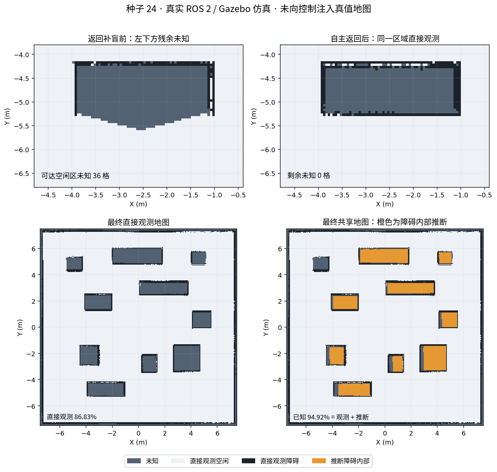

# 探索补盲与障碍补全修复（2026-10-26）

针对种子 24 实际仿真中“起点附近有遗漏却没有返回”“障碍内部未知拉低已观测比例”两项反馈。本次从 `30bf6d8254ef30332c58b7424269f421e948661d` 继续修复，交付分支仍为 `preview/seeded-scenes-15m`。

## 1. 遗漏区域与目标选择

原算法按局部窗口里的未知格数量评分，没有计算遮挡，因此墙后的未知格和实心障碍内部会吸引机器人反复绕行；先截取排名最高的 12 个候选再检查路径，可能遗漏分数较低但可达的角落；失败目标还会被永久加入黑名单。

已修改为：

- 先在已观测安全空闲区检查连通性，再计算目标分数。
- 用 180 个方向、3 m 范围的栅格视线估算可见未知面积，遇到已知障碍即停止；结合路径长度和最近访问记录选择目标。
- 对薄小的候选区补充采样，降低固定采样网格漏掉小角落的风险；降低原有的最小目标距离。
- 导航失败后只排除该目标周围 45 秒，到时重新尝试。
- 临时冷却或停放车辆造成的阻塞不算探索完成；没有可见可达前沿后还会持续复查 10 秒。
- 保留三矩形分工、受阻自动跨区和跨区轮流通行。正常导航仍只允许经过已观测安全空闲区。

网页新增**虚线：Nav2 当前规划**，实线继续表示已走轨迹。虚线来自每车实际发布的 `/robotN/plan`，仅接受坐标系为 `map`、数值有效、终点对应当前任务的路径。另显示目标预计可见未知面积及参考路线长度。

## 2. 障碍内部补全与比例

雷达主要观测物体表面，不能直接测量实心物体内部。新模块 `fleet_mapping/completion.py` 使用本课程的实心障碍假设，对充分支持的封闭轮廓推断内部占据，而非读取随机场景真值。

最终算法版本为 `closed-compact-solid-v3`：

- 轮廓必须闭合、紧凑、近似凸形；内部面积 0.15–10 m²，短边至少 0.45 m，长边不超过 4.8 m，避免把整间房或墙缝当实心物体。
- 容许补接最多 0.20 m 的栅格轮廓裂缝，低于机器人可通行开口宽度；原有的已观测空闲格始终保留，不写成障碍。
- 轮廓内部距边缘 0.15 m 的核心区域如存在空闲观测，则拒绝推断。
- 保留各车原始概率 ≥55 的边缘作为辅助证据，避免三值化时丢失中等置信度轮廓；至少一半轮廓仍须有融合地图中 ≥65 的强占据支持。只有中等概率的轮廓不能独立建立障碍，原有空闲观测仍保护。
- 至少 3 次新的地图更新、持续至少 2 秒支持后才启用。已确认的推断最多保留 5 秒抵抗短暂裂缝；核心出现矛盾空闲观测则立即撤回。
- 每次仅将原始 SLAM 融合中的未知格推断为占据，保留来源和计数，不将推断结果反馈成“原始观测”。

网页改为分别显示：

**地图已知比例 = 直接观测比例 + 封闭障碍推断比例。**

它与独立真值评估的“可达空闲区覆盖率”不同。证据不足的物体内部、外墙厚度和其他剩余未知区不会被强制填充，因此不保证显示 100%。

保存结果新增 `observed_map.pgm/.yaml`、`contour_evidence_map.pgm/.yaml`、`inferred_obstacles.pgm/.yaml`、`mapping_evidence.json`；`shared_map` 包含得到支持的障碍推断。可以逐格核对原始观测、辅助轮廓和推断。

## 3. 实测证据

结构化摘要见 [frontier-completion-evidence-20261026.json](frontier-completion-evidence-20261026.json)。原始轨迹、地图、PBStream、日志保留本机运行目录，不上传大型产物。所有机器人目标均由正常“开始探索”触发，没有人工指定补盲目标，没有注入地图、定位或速度。

### 同一历史地图对照

使用此前真实保存的地图及同一起点 `(-5,-5)`：旧算法选择障碍上方 `(-2.675,-3.875)`，新算法选择下方 `(-3.575,-5.675)`；两者均在真实输入地图上检查安全路径。这是固定快照对照，不是两轮导航性能的因果比较。

### 首轮闭环验证

运行 `runs/frontier-contour-seed24-20261026/`，真实 Gazebo Fortress / ROS 2 Humble，种子 24、Navfn、探索 480 秒。首轮采用更严格的 0.10 m 裂缝阈值且尚无 5 秒保持，是迭代证据，不冒充最终版本结果。

| 项目 | 首轮结果 |
| --- | --- |
| 左下方返回目标 | robot2 自主选择 `(-2.375,-5.975)`，有实际导航及真值轨迹 |
| 左下检查区 `[-4,-6.3,-1,-5.3]` | 可达空闲格 1,020；中期剩余未知 50 格，最终 0 格 |
| 全场可达空闲区覆盖率 | 99.955% |
| 地图已知比例 | 92.346% = 直接观测 86.084% + 障碍推断 6.261% |
| 推断占据检查 | 5,635 格全部位于真实障碍范围内，原始已观测格全部保留 |
| 碰撞与分区检查 | 通过 |
| 地图真实重载 | 90,000 格逐格一致 |
| 退出 | 监督脚本及 launch 为 0，无异常子进程，无残留 |

首轮发现轮廓细裂缝造成推断频繁撤回，因此后续使用 0.20 m 有界裂缝处理和 5 秒短期保持。第二轮 `frontier-contour-final24-20261026` 同样探索 480 秒，左下检查区未知 52→0，全场可达空闲区覆盖率 99.9955%，已知比例 90.760%；3,916 个推断格全部在真实障碍内，观测保留、重载和退出通过。

继续检查各车原始概率后，发现三值化会丢失部分 55–64 的物体边缘，最终版增加辅助轮廓证据及强占据支持要求，并保护与辅助证据冲突的可通行空闲开口。一轮短暂调试启动被主动停止，不计入完整通过样本。独立回放实际各车地图时，直接观测 86.370%、已知 93.632%，6,536 个推断格均在真实障碍内；该回放使用实际地图快照，不能当作完整导航运行。

### 最终版本闭环验证

运行 `runs/frontier-contour-v3-safe-20261026/`，使用上述最终 v3 代码、种子 24、Navfn，正常待命后探索 480 秒。运行期间源码哈希保持不变，并与 GitHub 交付目录逐文件核对一致。

| 项目 | 最终结果 |
| --- | --- |
| 左下方返回目标 | robot3 自主选择 `(-1.475,-5.675)`，有实际导航及真值轨迹 |
| 同一左下检查区 | 中期剩余未知 36 格，最终 0 格；1,020 个可达空闲格全部正确观测 |
| 独立可达空闲区覆盖率 | **100.000%**；三个分区均为 100% |
| 网页地图已知比例 | **94.918% = 直接观测 86.826% + 障碍推断 8.092%** |
| 推断占据检查 | **7,283 格全部位于真实障碍范围内**；全部原始已观测格保留 |
| 真实探索距离 | robot1 / robot2 / robot3 为 23.431 / 28.778 / 26.190 m |
| 最小静态 / 车间车体净空 | 0.111 / 0.184 m；独立碰撞与分区检查通过 |
| 地图真实重载 | 90,000 格逐格一致；未知 4,574 / 空闲 72,670 / 占据 12,756 |
| 退出 | 监督脚本及 launch 为 0，无异常子进程，无残留 |

三轮完整运行均为同一几何种子，但 SLAM 调度、目标选择和就绪后的待命时间不同，不把轮间百分比差异解释为严格的性能因果比较。最终 100% 是该轮**独立评估的可达空闲区覆盖率**，网页的 94.918% 是整幅地图的观测与推断比例，两者不能互换。其余约 5.08% 尚无充分依据的栅格保持未知；这组结果不保证所有种子都达到相同比例。



上图全部来自保存的真实 SLAM 地图；橙色仅在报告中突出推断来源，运行网页中这些格按障碍显示。左下比较区的可达格筛选及障碍核对使用真值做离线评估，不参与机器人目标或控制。

### 自动检查

- 多机器人 5 个 ROS 包重新构建；**100 项 Python 测试通过**，包含新增 20 个用例。
- 新增检查覆盖墙后信息不计分、小角落及薄前沿不遗漏、失败目标重新可选、冷却不冒充完成、完成前稳定复查、闭合实心障碍补全、开放/可通行开口/有空闲内部不误填、时间与新地图证据要求、短期保持及撤回、来源计数、规划路径输入边界。
- 原生桥接生命周期探针 0/9 残留，tf2 锁顺序回归通过；交付目录再次构建和执行全部测试通过。
- Chromium 156 实际打开新页面，接收真实规划路径，分别显示观测与推断，页面脚本错误为 0。页面会定时轮询，首个使用网络空闲条件的浏览器检查曾超时；改为 DOM 加载及内容条件后通过，不将超时记录计作页面通过。
- 额外生成 100 组输入，覆盖 0.025 / 0.05 / 0.10 m 分辨率，每组检查强占据与中等边缘组合、0.45 m 通行开口、已观测空闲房间及仅中等概率轮廓，共 400 项断言通过。

## 4. 使用

结束旧实例后重新启动，浏览器强制刷新：

```bash
cd /home/bwz/turtlebot_fleet_ws
./run.sh --seed 24
```

等待就绪后点“开始 / 恢复探索”。观察彩色虚线的当前规划与实线的历史轨迹；地图已知比例下方会显示直接观测与封闭障碍推断的分项。
