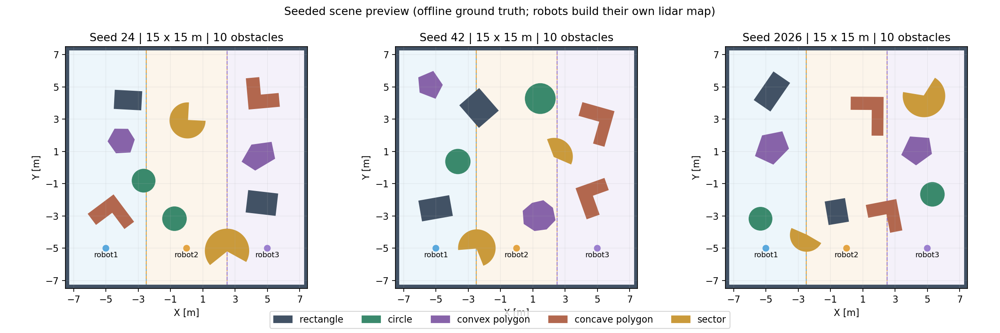
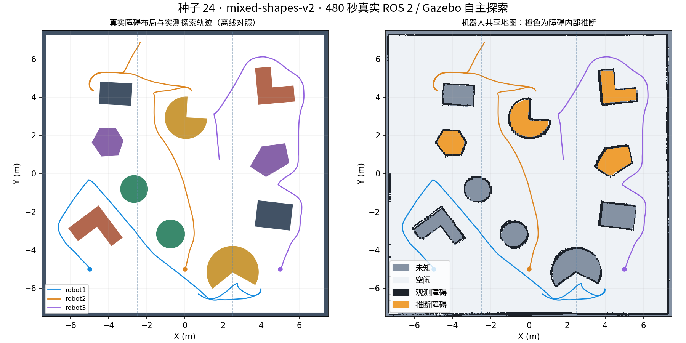

# 混合形状障碍与真实仿真（2026-10-26）

本轮将随机场景升级为 `mixed-shapes-v2`，保留 15×15 m、三个矩形初始任务区、种子复现及自动跨区补盲。源工作空间为 `/home/bwz/turtlebot_fleet_ws`，GitHub 对应 `multi_robot/`。

## 新增形状

| 形状 | 默认数量 | 生成范围 / 实现 |
| --- | ---: | --- |
| 旋转矩形 | 2 | 边长 1.1–2.1 m / 1.1–2.3 m，SDF box |
| 凸多边形 | 2 | 5–8 个初始顶点取凸包，封闭立体 STL |
| 凹多边形 | 2 | L 形，整体宽高 1.8–2.4 m，臂宽 0.65–0.85 m |
| 圆形 | 2 | 半径 0.65–1.05 m，SDF cylinder |
| 扇形 | 2 | 半径 1.0–1.35 m，圆心角 100–280°，包含优扇形 |

非圆形障碍随机旋转 `[-π,π]`；圆形的旋转不改变外形。扇形圆弧用角步长不超过 0.08 rad 的线段近似，最大弦误差约 1.1 mm。所有障碍高 1.2 m。凹多边形及优扇形的视觉网格保留完整轮廓，碰撞网格用凸三棱柱分片，避免物理引擎将凹口填成凸包。STL、圆柱及碰撞几何的依据见 [SDFormat 几何规范](https://sdformat.org/spec/?elem=geometry&ver=1.6) 和 [Gazebo Fortress 模型文档](https://gazebosim.org/docs/fortress/building_robot/)。

生成器检查实际旋转轮廓的距离：障碍间及到围墙的间隔至少 1.2 m，起点和中央集合空间保留。再以 0.1 m 分辨率检查离障碍至少 0.5 m 的中心可通行区域，要求单连通、包含全部三个起点、占场地至少 50%。过密配置采样失败会明确报错。此检查是离散几何检查，不能保证任意导航任务都成功。



上图是离线真值布局；机器人仍使用激光、里程计和 SLAM 地图探索。

## 建图与评估适配

- 独立评估支持圆形及任意简单多边形，使用真实轮廓计算覆盖与静态间隙；历史五元组矩形记录仍可读取。
- 障碍内部补全升级为 `closed-compact-solid-v4`：采用实际封闭区域，保留凹口，不填充凸包。区域面积与凸包面积比至少 0.55；凹形轮廓要求至少 65% 的边缘具有强占据证据。原有 3 次新更新、2 秒稳定、空闲观测保护和最多 5 秒保留机制继续有效。
- 网页显示当前生成器为“混合形状”，轨迹、Nav2 当前规划虚线和观测 / 推断比例继续显示。
- 未新增运行依赖；清理了 `fleet_mapping/package.xml` 的重复 SciPy 依赖声明。生成期间发现并修复了 NumPy 标量导致 YAML 导出失败的问题。

## 已完成检查

1. 两份工作空间均构建 5 个包成功，122 项 Python 测试通过。新增覆盖旋转几何、交叉多边形距离、圆形射线、凹形三角剖分、网格闭合与朝外、体积、模型导出一致性及凹口补全保护。
2. 桥接生命周期探针保留节点 `0/9`，TF 锁回归通过。
3. 34 个种子（0–29、42、2026、12345、`2^63-1`）全部生成成功并通过连通性和间隔检查。每个默认场景均含五种形状各两个。测试不代表所有可能的种子均已穷举。
4. 100 个随机旋转形状 × 3 个分辨率（0.025、0.05、0.1 m）执行 1200 项补全核对：300 个封闭实心轮廓均产生推断；不覆盖直接观测，不填充已知凹口，仅有中等强度边缘时不建立障碍，深部空闲观测会阻止补全。
5. 与修改前代码逐项比较，旧生成器种子 0、24、42、2026 的几何及全部元数据完全一致。
6. `ign sdf -k` 校验通过，实际 Gazebo 加载网格无资源错误。基础物理探针在两个 L 形和两个优扇形的缺口放入 robot1，稳定停留并读取内侧激光；这是专门的基础仿真探针，完整自主探索没有传送机器人。
7. 实际 640 线激光在 7 个视点核对共 4384 条有效射线。各类形状的 95 分位绝对距离误差均低于 6 cm；凸多边形约 4.69 cm，其余形状低于 1.72 cm。原始边缘异常值保留在统计中，不承诺每条射线都低于该值。
8. Chromium 156 实际打开网页，混合形状标签正确，无 JavaScript 错误。该轮浏览器检查只读取页面，不与自主探索脚本争用控制命令。

## 480 秒自主探索结果

种子 24、默认 Navfn 规划器、三个机器人从起点自主探索，未注入真值地图、位姿或速度。基础探针与本轮为独立冷启动。

| 指标 | 本轮结果 |
| --- | --- |
| 真值可达空闲区覆盖率 | 100%，三个分区分别为 100% |
| 保存地图已知比例 | 91.35% = 直接观测 88.25% + 障碍内部推断 3.10% |
| 推断障碍格 | 2791 格，全部位于真实障碍内；未覆盖任何直接观测格 |
| 实际探索里程 | robot1 21.71 m、robot2 22.58 m、robot3 20.11 m |
| 最小机器人外缘到静态障碍间隙 | 0.1543 m |
| 最小机器人外缘间距 | 4.0204 m |
| 自动跨区 | 仿真时刻 41.905 s，分区阻断实时地图中的可达路径后触发 |
| 地图重新加载 | Nav2 map_server 的 90000 格与保存地图完全一致 |
| 退出 | 启动器返回 0，无异常进程退出或残留 |
| 源码核对 | 117 个运行源文件在试验期间未变化，与待上传源码一致 |



可达空闲区覆盖率与网页已知比例的分母不同：前者只统计机器人能够安全抵达的空闲区，后者包括障碍内部与围墙等所有地图格。保存时部分障碍内部闭合证据不足，仍保持未知。本轮为定时 480 秒试验后主动暂停保存，不能据此声称所有种子都能自动结束探索，或地图所有格都已观测。试验中已知比例会随 SLAM 及推断证据的更新波动，瞬时最大值不能代替保存结果。

证据摘要见 [mixed-shapes-evidence-20261026.json](mixed-shapes-evidence-20261026.json)。原始日志、真值与地图保留在本机 `runs/mixed-base24b-20261026/`、`runs/mixed-full24-20261026/`；早期导出失败的 `mixed-base24-20261026/` 不计为成功运行。

## 使用方法

```bash
cd /home/bwz/turtlebot_fleet_ws
./run.sh --seed 24
```

打开 `http://127.0.0.1:8765`，等待三车就绪后点击“开始 / 恢复探索”。`./run.sh` 不带种子时每次生成新地图。关闭时在启动终端按 Ctrl+C。

```bash
# 重现历史的纯矩形场景
./run.sh --seed 24 --scene-generator rectangles-v1

# 不开 Gazebo 窗口，保留网页
./run.sh --headless --seed 42

# 只生成布局预览，不启动机器人
source ./env.sh
python3 scripts/preview_scene.py --seeds 24 42 2026 --output /tmp/mixed-scenes.png
```

同一数字种子在新旧生成器中对应不同布局；复现时需同时记录生成器版本、种子和配置。地图几何可复现，SLAM 与机器人轨迹仍可能因运行时调度而不同。
