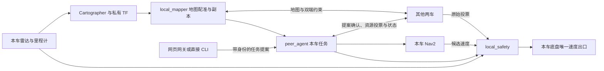

# 三机器人算法与工程结构

三辆 TurtleBot 位于同一个 15×15 m 仿真场地。默认去中心化模式下，各车的 SLAM、导航、任务代理与安全节点各自运行，并通过 ROS 2 对等主题交换可验证的状态、地图、约束和投票。操作界面可由网页或 CLI 提供。

## 每车运行链路

1. **本地感知与导航。** 各车的雷达、里程计和私有 TF 支撑 Cartographer 与 Nav2。建图得到本车原始地图，Nav2 规划由本车执行。
2. **建立共同坐标。** `local_mapper` 收集带身份的原始局部地图副本，检查几何匹配并建立双端确认的配准约束。首次组队可在双端确认后用停车后的观测连续性作进一步证明。接纳还要求连续静止和位姿稳定。定位流程使用观测数据推断机器人之间的坐标关系，世界边界、出生位姿与真值由独立验收链路使用。
3. **分区和任务。** `peer_agent` 按共同坐标验证探索分区、巡逻航点和队形目标。探索时各车在分区内推进，由通行资源租约约束可能冲突的路段。切换队形前从停车位姿及观测地图计算目标，车辆逐个进入其槽位并驻停。
4. **速度授权。** `local_safety` 直接接收投票者的原始消息，结合当前授权、雷达和运动状态核对速度。每个底盘的最终话题为 `/<机器人名>/diffdrive_controller/cmd_vel_unstamped`。失去有效许可时由该车安全节点停车，差速控制器还设置了 0.5 秒指令超时。

## 身份、租约与恢复

| 对象 | 有效依据 |
| --- | --- |
| 车辆会话 | 本轮 `session`、`robot`、`boot`。接受地图和约束还需对应地图 `epoch` |
| 团队地图 | 由观测配准生成的参考坐标及当前帧身份。巡逻任务携带同一 `coordinate_frame` |
| 通行许可 | 同一任务、请求、资源和坐标基准下的多数投票。持有者授权窗口 0.5 秒，投票者排他占用 2 秒 |
| 重启 | 新 `boot/epoch` 接纳需要停车后重新匹配。废弃旧任务并保留急停锁定。解除后由操作者重新下发任务 |
| 观测断连 | 原有授权按有效期失效。迟到或重复票无法为旧请求延长窗口 |

重新配准和参考坐标变化均由独立评估按最初坐标基准核对。评估汇集运行事件、遥测、地图检查点及真值，逐一检查已接纳的身份。如果缺少证据，该身份计作未验证。初始自主探索使用各车位置的同步平移采样，原地转动与后续故障恢复里程分别记录。分阶段结果可独立复评。

## 操作、记录与隔离

`peer_gateway` 为网页整理状态、地图和提案。浏览器及网关退出后，`fleetctl` 仍能经 DDS 与各车通信。运行监督脚本负责启动和退出同一世界、保留配置与进程证据。`truth_probe` 仅由验收入口或显式 `--record-truth` 启用，运动、地图配准与任务控制节点使用自身观测和对等消息。

`env.sh` 按本机回环通信配置运行域。单调时钟假设、DDS 配置和共享运行目录适用于同主机三车。要扩展到不同主机，需重新定义时钟、通信边界和运行状态持久化。

## 代码位置

| 路径 | 职责 |
| --- | --- |
| [fleet_bringup](../src/fleet_bringup/) | 生成场地、启动三车节点、管理仿真进程与旧实例检查 |
| [fleet_bridge](../src/fleet_bridge/) | Gazebo 服务器、ROS 与 Gazebo Transport 桥接 |
| [fleet_interfaces](../src/fleet_interfaces/) | 原始地图、任务提案、配准约束、租约与授权消息 |
| [fleet_mapping](../src/fleet_mapping/) | 栅格、几何配准、融合、连续性与探索完成判定 |
| [fleet_control](../src/fleet_control/) | `local_mapper`、`peer_agent`、`local_safety`、CLI、网关与独立评估 |
| [scripts](../scripts/) | 运行监督、统一演示、专项验收、记录与故障证据 |
| [vendor/tf2_compat](../vendor/tf2_compat/) | 从 geometry2 0.25.23 导入的项目本地锁顺序补丁和原生回归 |

集中式兼容入口使用已知起点和公共协调器，共享同一套仿真和桥接基础设施。默认场景的实测和完整版专项验收的区别见[验证与范围](验证与范围.md)。
