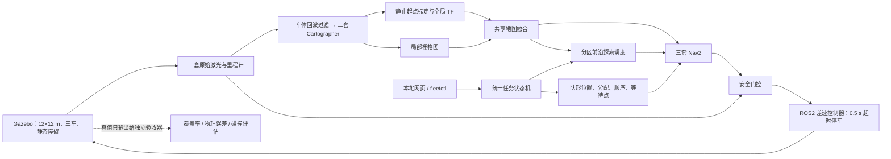

# 算法与工程结构

## 整体数据流



四个 ROS 包中，`fleet_interfaces` 为 CMake 接口包，其余为 Python 包。`vendor/tf2_compat` 是针对本机 tf2 0.25.23 死锁的本地兼容库，不是第五个业务包，不修改系统库。

## 仿真与坐标

从系统安装的官方 TurtleBot4 Lite Xacro 生成 URDF，保留外形、碰撞、轮胎摩擦、悬挂和 ROS2 控制接口。删除相机、红外、悬崖、充电座及额外 Create3 节点；场地统一加载 Physics、Sensors、Contact 等世界插件，三台 GPU 雷达使用 Ogre2、640 线、10 Hz。

场地外墙的外边界为 ±6 m；内侧边界为 ±5.8 m。隔墙和箱体由场景生成器写入 SDF。`ground_truth.yaml` 只供独立离线评估器读取，不由建图或控制模块导入。

三车的 TF 主链：

```text
map
 ├─ robot1/map → robot1/odom → robot1/base_link → robot1/rplidar_link
 ├─ robot2/map → robot2/odom → robot2/base_link → robot2/rplidar_link
 └─ robot3/map → robot3/odom → robot3/base_link → robot3/rplidar_link
```

`robot_state_publisher.frame_prefix` 处理本体前缀；差速控制器直接设置带前缀的 odom/base 帧，并关闭控制器的自动前缀，防止二次前缀。所有模块使用同一 `/clock`。

三车先静止。读到首帧局部 SLAM 位姿后，计算：

```text
T_global_local = T_known_start_base × inverse(T_local_base)
```

不假设第一帧 SLAM 的 base 恰好在局部地图零点。标定后发布固定变换。所有导航运行在 SLAM 的估计坐标中，不消费 Gazebo 真值。悬挂的被动关节状态也由控制硬件读取，避免轮子 TF 与车体断开。

## 地图与协同探索

共享图固定为 240×240、0.05 m/格。局部栅格先按原点姿态变换，再按标定变换投影到共享网格：

- 局部占据概率 ≥65：障碍 `100`。
- 局部概率 0–25：已观测空闲 `0`。
- 其余：未知 `-1`。
- 障碍优先；任一车的未知不能覆盖另一车已观测的结果。

融合的是各车当前 SLAM 栅格，每次重新计算；不是把历史障碍永久累加，也不生成场地真值地图。

SLAM 输入会把落在其他机器人估计车体范围内的回波设为 NaN，含义是忽略该测量，不能把车后方空间误标为空闲。导航和即时安全停车继续读取未过滤的原始测距。

探索器在空闲 / 未知边界附近选择有车体余量的已观测空闲点，对候选点做采样和空间去重，按未知栅格信息量、视角新颖性、路径长度及其他车辆已领取的目标评分。A* 排除障碍、未知、贴边和不可达目标。导航失败的点进入避让列表。它不使用预先给定的方形巡航路线。

若某车的可达前沿暂时耗尽且累计行驶仍少于参与门槛，探索器会从该车区域内的已观测空闲区域选择新的观测视角。探索里程来自里程计平移量；原地旋转产生的 SLAM 抖动不计入里程。最终再用 Gazebo 实际轨迹独立复核。

## 区域约束

每车有一份 KeepoutFilter 掩膜，同时用于全局和局部代价地图。矩形边界先内缩 0.35 m；导航目标与探索路径中心进一步留出车体对过滤区的余量，防止车心恰在掩膜边缘时反复碰撞检查失败。安全门控还检查短时预测位置。

分区是导航策略，不写入共享地图的障碍。第一次开始前可以调整三个矩形，但须不重叠、覆盖场地、包含各自起点。队形阶段取消目标并确认停车后，关闭过滤器、清空旧代价并等新一轮更新；返回探索时，先回到各自区域，再重新开启过滤器。

## 队形与任务状态

横排：`(0,-d),(0,0),(0,d)`；纵队：`(-d,0),(0,0),(d,0)`；三角形：`(d/√3,0),(-d/(2√3),±d/2)`。再按中心和朝向做 SE(2) 变换。

枚举 6 种位置分配、6 种到位顺序。每一步都把其余两台车当作占据空间，检查已观测空闲区里的可行路径，以总长度选方案。无直接可行顺序时，尝试一个已探索的安全临时等待点；仍不可行则停车并说明原因。实际到位由 Nav2 规划、跟踪与原始雷达避障完成，三车分步移动。

导航返回成功后，额外检查所有车的位置误差 ≤0.15 m、朝向误差 ≤10°，持续 3 秒，才进入 `FORMATION_READY`。不能只把 Action 的成功状态当成队形验收。

状态包括：`BOOTSTRAP`、`IDLE`、`SWITCHING`、`EXPLORING`、`EXPLORED`、`FORMING`、`FORMATION_READY`、`RETURNING`、`ESTOP`、`FAULT`。

长操作在工作线程中执行。每个操作携带递增任务代号；取消、急停和新任务都会使旧操作失效，旧操作不能在稍后重新释放速度。

## 安全与启动

导航速度先送 `/<robot>/cmd_vel_nav`，安全门控是原生控制器速度话题的唯一发布者。门控检查调度心跳、急停、任务授权、雷达、里程计、TF、分区边界、近障和速度时效。未授权或数据不新鲜时持续发布零速度；门控自身退出时，底盘控制器还有 0.5 秒的独立指令超时。

调度器也检查三套导航的生命周期和六张代价地图所发布的机器人位姿是否持续更新，防止“外部 TF 正常、导航内部 TF 已冻结”的隐蔽故障。急停解除只回到待命，必须重新下发任务。

启动按实际数据就绪推进：生成三车 → 控制器与雷达 → SLAM 与静止标定 → 完整 TF 和局部图稳定 → 三套 Nav2 → 全部生命周期及位姿新鲜 → 允许任务。

## ROS 接口

| 接口 | 类型 / 用途 |
|---|---|
| `/map` | `nav_msgs/OccupancyGrid`，共享图，持久 QoS |
| `/<robot>/scan` | 原始 `LaserScan` |
| `/<robot>/scan_slam` | 仅供 SLAM 的车体回波过滤扫描 |
| `/<robot>/odom` | 各车里程计 |
| `/<robot>/local_map` | 各车 Cartographer 栅格 |
| `/<robot>/navigate_to_pose` | Nav2 导航 Action |
| `/<robot>/keepout_mask`、`keepout_info` | 分区过滤掩膜 |
| `/fleet/set_regions` | `fleet_interfaces/SetRegions` |
| `/fleet/set_formation` | `fleet_interfaces/SetFormation` |
| `/fleet/command` | `fleet_interfaces/FleetCommand` |
| `/fleet/state` | JSON 状态 `std_msgs/String` |
| `/fleet/drive_lease` | 调度到门控的短时运动授权 |
| `/fleet/safety_state` | 三车停车 / 运动门控原因 |

网页和 CLI 都调用上述服务，不各自维护一套任务逻辑。

## 边界

首版固定三车、已知起点、静态场地，支持集合切换队形，不支持保持队形整体运动。不做未知初始位姿自动配准和联合位姿图优化。PGM/YAML 重载检查和 PBStream 保存已提供；默认启动从固定起点重新建图，不自动恢复上一轮任务。
