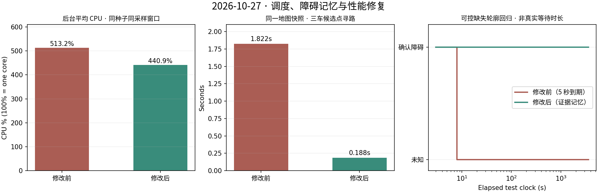

# 调度、障碍稳定性与性能修复（2026-10-27）

对应用户反馈：更近的车没有执行目标、已标记障碍反复退回未知、仿真开销偏大。本轮以 `8aa2dce` 为修改前版本，实际运行修改前后两轮仿真，并保留原始数据。

## 1. 派车原因与修复

原因在调度层：解除分区后的旧代码通过 `cross_region_next` 固定轮换机器人。即使另一台车有更短的路径，仍会等待当前轮次的车执行。

现在每台车提出可达前沿，合并为公共候选目标；对同一个目标比较三台车的安全路径长度，选最短可行路径的车执行，再综合可见未知面积和路径代价选择目标。避开其他停放机器人、未知区和障碍，失败目标冷却仍生效。一次一车通过共享通道的保护保留，取消强制轮换及为满足里程而让车辆额外运动的跨区完成条件。

这里的“近”指可通行路径长度：直线距离近的车可能被墙、停放车辆或当前分区阻挡。初始阶段仍遵守用户的矩形分工；自动解除分区后才使用全局就近派车。`events.jsonl` 的 `frontier_selected` 记录 `route_costs_m`、选中车辆和 `assignment_policy`，可核对每次分配。

本轮 17 次跨区分配全部满足：选中车辆的路径长度等于该目标所有可行车辆路径长度的最小值。另有单元测试覆盖直线更近但需绕墙、最近车辆冷却、共享通道串行及不强制轮换。

## 2. 障碍反复退回未知的原因与重点修复

旧版有两条会丢失确认结果的路径：

- 已推断区域超过 5 秒没有完整轮廓支持就被清除。
- 记忆直接等于本帧的“未知且被推断”掩码；某格暂时被 SLAM 直接标成障碍时，反而会丢掉此前记忆，之后再变未知便无法保留。

当前策略为 `persistent-obstacle-evidence-v5`：

1. 沿用闭合轮廓、至少 3 次新更新、至少 2 秒的确认门槛。确认后在本轮运行中保留，未知、轮廓暂缺、等待时间经过均不是反证。
2. 反复直接观测到的占据边缘也记录历史证据，避免整个物体仅剩内部稳定、边缘仍闪烁。
3. 当前直接观测为空闲的格立即保持空闲，不被历史障碍覆盖。
4. 撤回整个内部推断，需要核心区域出现连片空闲反证：连续至少 3 次新地图更新、持续至少 2 秒，面积满足 **0.02 m²、核心面积的 2%、4 格三者中的最大值**。单点短时噪声不会推翻整块物体。
5. 历史直接占据格获得连续 3 次新更新、持续至少 2 秒的空闲反证后，清除该格的历史占据记忆。地图尺寸 / 分辨率改变会重建记忆；新启动的随机场景也重新建立记忆。
6. 输出继续区分当前直接观测与障碍推断 / 证据保留；保存指标额外列出 `retained_obstacle_cells`，不将历史证据冒充本帧观测。

验证结果：被动订阅器记录 609 次地图更新，持续占据至少 3 秒的格 **0 次退回未知**；短于确认门槛的边缘共发生 425 格次占据到未知跳变，这些临时噪声不作永久锁存。自然仿真中没有触发整块反证撤回；可控单元测试验证了缺失轮廓 1 小时的模拟时钟后仍保留、稳定空闲反证会撤回、重复定时调用不能充当新证据、直接占据到未知的记忆，以及立即保留空闲观测。这不是实际等待 1 小时的仿真。

保存时 7092 格使用障碍推断 / 历史证据，其中 1199 格属于推断轮廓以外的历史直接占据保留。所有本帧直接观测格保持原值。对照真值，82 格位于真实边界外，最远约 7.8 cm；无超过 15 cm 的误填。这些边界误差说明证据记忆不能消除 SLAM 的测量与栅格误差。

## 3. 不必要开销与修复

| 检查结果 | 修改 |
| --- | --- |
| 每个候选点分别执行 Python A*，一次三车规划调用了 48 次 A* | 每车一次 SciPy 最短距离场，候选点复用；保留对角线不可穿墙规则 |
| 多车反复计算同一视点的未知可见面积 | 在同一地图快照中缓存可见面积 |
| 相同地图心跳也重建距离变换、生成 PNG | 地图内容未变时复用 Grid 和 PNG；地图数据未变时不重发完整 `/map`，瞬态本地 QoS 保留给新订阅者 |
| 每 0.5 秒无条件重复融合，未区分新地图 | 仅在局部地图版本或对齐状态变化时重新融合，状态心跳继续发送 |
| 导航启动完毕仍处理全量 TF 和仿真时钟 | 启动检查完成后销毁该节点订阅，继续负责 Nav2 子进程清理 |
| 10 Hz 构造和发布网页状态，网页只以 2 Hz 读取 | 状态改为 2 Hz；安全租约保留 10 Hz |
| GUI 固定设置 `LIBGL_ALWAYS_SOFTWARE=1` | 默认硬件渲染，保留显式软件兼容模式 |
| 网格合法性用 Python 逐格比较 | 改为 NumPy 范围检查；维度检查继续保留 |

动态关节 TF 限制为 10 Hz；固定传感器安装关系仍使用静态 TF。雷达保持 10 Hz、安全检查 20 Hz、里程计 30 Hz、地图分辨率 0.05 m、物理步长 0.005 s 均未降低。



### 性能测量条件与结果

同一台电脑、同一种子 24、同一配置、均不开 GUI。读取本轮启动进程及其后代的 `/proc/<pid>/stat` CPU 时间，每约 2 秒采样；比较探索开始后的第 30–170 秒，两组各 69 个样本。`100%` 表示一个逻辑核心，CPU 数值不是整机利用率。

| 指标 | 修改前 | 修改后 |
| --- | ---: | ---: |
| 后台平均 CPU | 513.2% | 440.9% |
| 后台 CPU 中位数 | 510.8% | 456.3% |
| 启动检查进程平均 CPU | 28.13% | 0.04% |
| 后台 RSS 中位数 | 1854.3 MiB | 1886.7 MiB |
| 固定地图快照的三车候选寻路一次分析 | 1.822 s | 0.188 s |

本轮平均 CPU 下降 **14.1%**。内存没有下降，距离场和证据记忆需要缓存。固定快照耗时约下降 89.7%，该项是同一输入的一次 cProfile 分析，不能直接换算为整套仿真的加速比。运行测试各执行一轮；新调度改变了轨迹、地图数据和 SLAM 负载，不能视为严格因果实验或所有电脑的性能保证。

硬件 GUI 另行开启验证，通过 OpenGL 3+ 初始化，日志显示 `Mesa Intel(R) Graphics (RPL-S)`，未使用 llvmpipe 软件光栅化，GUI 正常关闭。该检查在 CPU 对照窗口之后执行。物理仿真、GPU 激光、三套 SLAM / Nav2 仍有实际运行开销，不承诺风扇不转。

## 4. 仿真与回归

- 两份工作空间均构建 5 个包成功，140 项 Python 测试通过；桥接生命周期探针残留节点 `0/9`，TF 锁回归通过。
- 修改前运行 180 秒作为开销基线；修改后运行 480 秒。不同持续时间的覆盖率不用于宣称探索速度提高。
- 修改后真值可达空闲区覆盖率 **100%**，三个分区均 **100%**。
- 保存地图已知比例 **95.54%**，其中当前直接观测 **87.66%**，障碍推断 / 历史证据 **7.88%**。地图已知比例与可达空闲区覆盖率分母不同。
- 实际探索里程：robot1 **29.83 m**、robot2 **22.28 m**、robot3 **7.11 m**。分工不要求三车里程均等。
- 机器人外缘到静态障碍最小间隙 **0.1136 m**；机器人外缘间最小间隙 **2.6800 m**，碰撞与分区检查通过。
- Nav2 map_server 重新加载，**90000 格完全一致**。
- Chromium 156 显示就近派车及证据保留状态，无 JavaScript 错误。
- 探索完成保存后另做故障注入：挂起实际运动机器人的 BT 导航节点，约 **2.28 秒**内网页报告故障停车；后续观测三车实际位移均为 0。安全频率未因性能优化而降低。
- 117 个运行源文件在测试期间未变化，与待上传源码一致。启动器退出 0，无异常子进程退出及残留；端口 8765、8766 已释放。

证据摘要：[scheduling-memory-performance-evidence-20261027.json](scheduling-memory-performance-evidence-20261027.json)。原始日志、地图、CPU 样本和诊断保留在本机 `runs/before-fixes24-20261027/`、`runs/after-fixes24-20261027/`；固定快照分析在 `runs/planner-profile-comparison-20261027.json`。被动地图观察器由人工 SIGINT 结束并在 `finally` 中保存统计，不属于被测仿真进程异常。

## 使用

```bash
cd /home/bwz/turtlebot_fleet_ws
./run.sh --seed 24

# 只通过网页操作，关闭 3D 窗口
./run.sh --headless --seed 24

# 图形驱动需要软件兼容模式时
FLEET_SOFTWARE_RENDERING=1 ./run.sh --seed 24
```

打开 `http://127.0.0.1:8765`，就绪后点击开始探索。启动终端 Ctrl+C 关闭整个实例。
