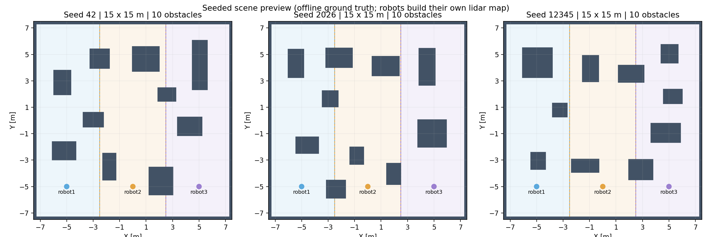
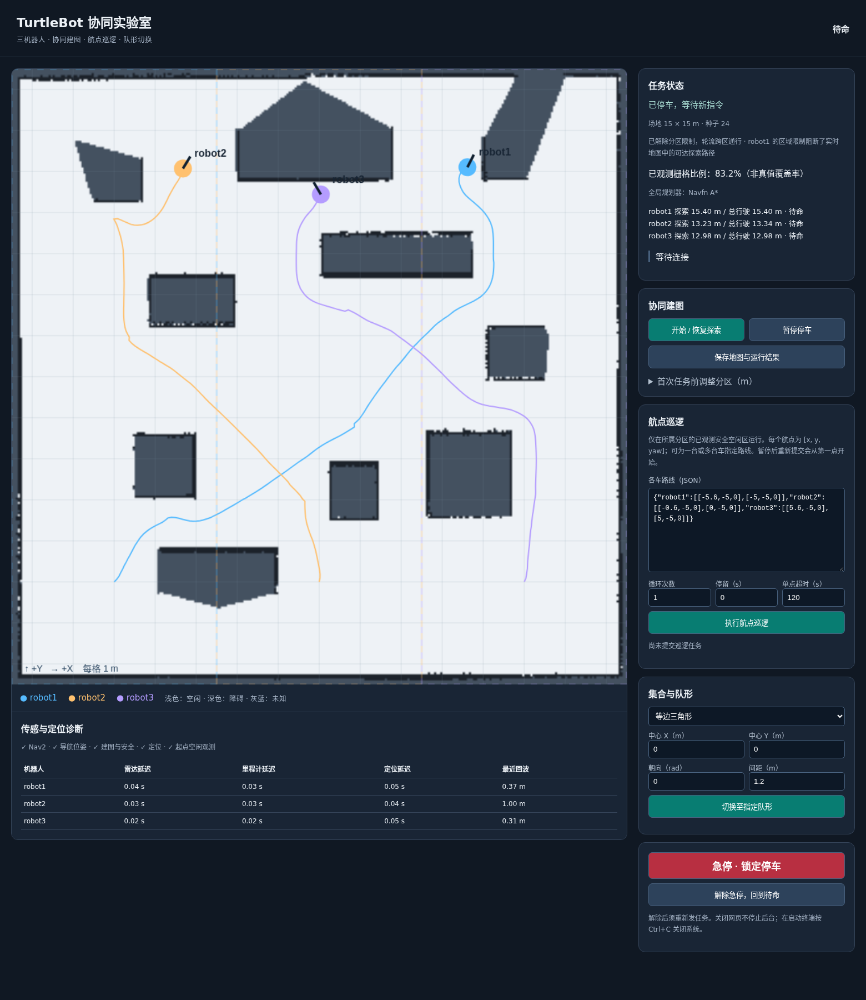

# 15×15 米随机场景与自适应分区：预览记录

本版用于查看新功能效果，代码位于 Git 分支 `preview/seeded-scenes-15m`。

## 已实现

- 默认每次启动选择新种子；`./run.sh --seed 24` 可复现指定场景。种子 0 有效，支持 0 到 2^63−1；网页以字符串显示，避免浏览器整数精度丢失。
- 场地 15×15 米，默认 10 个随机矩形障碍，短边至少 1 米，障碍与障碍/外墙的表面距离至少 1.2 米。保留三个起点及中央集合空间。
- 使用生成器 `rectangles-v1`，按种子、起点和障碍数量确定几何。先在 10 厘米网格检查具有 0.5 米中心净空的通行空间，要求单连通、包含三个起点且占场地至少 50%。不合格则重新采样，预算耗尽明确报错。
- 保留三个矩形初始分工；根据实时共享地图发现某个本区前沿必须绕出区域才能到达，且这一情况持续至少 8 秒后，停车、取消任务、关闭分区过滤器，再跨区探索。每 6 秒主动检查，也检查区域内已无目标的情形。
- 跨区后轮流执行探索目标，同一时间只允许一台车移动；规划中与其他停着的车中心保持至少 0.8 米距离。初始分区探索仍并行。暂停和解除急停后保留本轮跨区权限；恢复时不会强制返回初始分区。
- 网页显示种子、分区解除原因、轮流通行提示；地图、轨迹、米制网格、示例航点适配新尺寸。种子、几何哈希、连通性检查保存在 `assets/scene.json`。

建图和控制没有读取场景真值。下图是离线生成器预览，运行界面中的地图仍由雷达 SLAM 生成。



## 本次验证

- 构建 `fleet_bringup`、`fleet_control` 成功；63 项 Python 测试及原生 tf2 回归通过。
- 种子 0～99 全部生成成功并通过上述连通性检查，最小通行空间占比约 50.18%。这是一组种子样本，不等于穷尽所有种子。
- 两轮真实启动使用种子 24，`arena.sdf` 字节完全相同，SHA256 为 `ed88c3c879b364f2248e30c8d6f6c9d2a8debbf150ca32085033514731044ef9`；种子 42 与 24 的布局不同。
- 实际使用 Gazebo Fortress、ROS 2 Humble、Navfn A*；全程正常 API 下发目标，没有注入地图、定位或速度。

### 最终通行调度版本：种子 24，探索 240 秒

运行目录：`runs/random-traffic-seed24-20261026/`。以下覆盖率和距离取自该轮 `preview-summary.json`，属于限时探索结果。

| 检查 | 结果 |
| --- | --- |
| 可达区域覆盖率 | 97.459% |
| 原三个区域覆盖率 | 98.495% / 96.912% / 96.960% |
| 三车实际探索距离 | 15.404 / 13.177 / 12.979 米 |
| 自动解除分区 | 已触发，有事件记录和实际跨区轨迹 |
| 授权跨区采样数 | 4,354 |
| 分区约束仍启用时的越界采样数 | 0 |
| 最小静态障碍车体净空 | 0.132 米 |
| 最小两车车体间隙 | 0.498 米 |
| 跨区阶段同时平移的最大车辆数 | 1 |
| 真值碰撞检查 | 通过 |

随后检查暂停、恢复、运动中急停与解除急停：急停稳定后两秒内三车真值位移均为 0；解除急停只回到待命，恢复探索继续保留跨区权限。此后重新保存地图，Nav2 map_server 重载 90,000 格逐格一致：未知 15,092、空闲 70,972、占据 3,936。该最终保存晚于上表限时采样，二者用途不同。

退出检查未通过：停车、Gazebo 数据源退出及清理均完成，但安装于系统的 `ros_gz_bridge` 中 robot1 雷达桥、robot2 雷达桥和时钟桥在 SIGINT 退出时再次报 `free(): corrupted unsorted chunks`、退出码 −6。顶层 launch 返回 0，监督脚本因发现异常子进程正确返回 1，残留进程为 `[]`。本版没有修复该堆损坏根因，不能将这一轮计作正常退出通过。



结构化记录见 [本次证据摘要](random-preview-evidence-20261026.json)，种子样本见 [100 个种子记录](random-scene-100-seeds.json)。完整逐帧日志、轨迹和 PBStream 保留在本机 `runs/`，不纳入 Git。

## 迭代中发现的问题

1. 最初仅在分区目标耗尽后才检查是否需要跨区。种子 24 的一轮 240 秒检查没有触发该条件，脚本明确报出“没有触发自动跨区”；随后增加了对本区不连通前沿的主动检查。
2. 初版跨区时允许并行导航，虽然未记录到碰撞，但两车最小车体间隙仅 0.0127 米。最终版增加轮流通行与对停放车辆的规划净空，同种子复验测得最小间隙 0.498 米。两轮运行轨迹不同，不能将它解释为所有种子都具有固定的最小间距保证。
3. 调整覆盖率验收：只有在分区约束启用期间越界才算违规；解除后的跨区样本单独记录，碰撞检查始终启用。

## 当前边界

- 这是首个预览版。生成器的离散连通性检查不代表任意种子、任意参数下的导航或 100% 建图保证；遮挡、地图误差、目标失败仍可能留下未知区域。
- 跨区采用轮流通行以增大间距，速度比跨区并行探索慢，之后可进一步优化交通预约和避让。
- 本轮未重新完成随机场景下的三种队形全流程、Smac2D 全流程或长时间耐久验证。旧固定场景报告不作为这些新场景检查已通过的证据。
- 航点巡逻继续遵守人工矩形；若跨区后车已在原区外，请重新开始一轮再执行分区巡逻。
- 单机器人项目未改动；原版可从本机备份 `backups/before-random-scene-20261026.tar.gz` 恢复。旧的桥接退出内存错误本次仍复现，先关闭数据源的缓解不能完全消除它，根因尚未定位。

## 查看效果

```bash
cd /home/bwz/turtlebot_fleet_ws
./run.sh --seed 24
```

浏览器打开 `http://127.0.0.1:8765`，等待三车就绪后点击“开始 / 恢复探索”。使用 `./run.sh` 会选择新随机种子。结束时在启动终端按 Ctrl+C。
