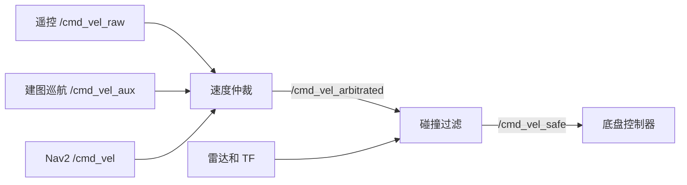

# 单机器人操作手册

按仿真、建图、保存、导航的顺序操作。每个新终端先进入 `single_robot` 并执行 `source ./env.sh`。使用 `TB4_DEMO_DOMAIN_ID` 或 `TB4_DEMO_PARTITION` 覆盖默认值时，所有终端应使用同一组值。

## 1. 仿真和传感器

终端 A 运行仿真。默认 `world:=warehouse`、`model:=lite`、`spawn_dock:=false`。需要无窗口运行时，同一命令使用 `gui:=false rviz:=false`。

```bash
ros2 launch turtlebot4_tutorial tutorial_simulation.launch.py gui:=true rviz:=true
```

终端 B 检查仿真时钟、底盘和传感器。持续输出的命令用 Ctrl+C 退出。

```bash
ros2 topic echo /clock --once
ros2 service call /controller_manager/list_controllers \
  controller_manager_msgs/srv/ListControllers '{}'
ros2 topic echo /scan --once --qos-reliability best_effort
ros2 topic echo /odom --once
ros2 topic echo /imu --once --qos-reliability best_effort
ros2 topic hz /scan
```

期望时钟递增，`joint_state_broadcaster` 与 `diffdrive_controller` 为 active。相机预览话题为 `/oakd/rgb/preview/image_raw`。RViz 的传感器显示使用 Best Effort，仿真固定坐标系用 `odom`，建图和导航用 `map`。可通过 `/sim_ground_truth_pose` 核对车体的实际仿真位移。

终端 B 运行 `ros2 run turtlebot4_tutorial keyboard_control`。焦点停留在键盘终端，使用英文输入法。W/S 前后、A/D 转向、空格停车、Q 退出，输入超时自动停止。官方 `teleop_twist_keyboard` 可单独使用，以其打印的按键为准。

## 2. 建图、保存与重载

先结束遥控。由下面的入口新建 Gazebo 和 Cartographer，或在已有相同仿真的情况下加 `start_sim:=false`。

```bash
ros2 launch turtlebot4_tutorial tutorial_mapping.launch.py gui:=true rviz:=true
```

在终端 B 用键盘探索，或者在默认仓库、原点附近从静止执行预设建图路线。

```bash
ros2 run turtlebot4_tutorial mapping_patrol --ros-args -p use_sim_time:=true
```

预设路线含转一周与约 0.9 m 边长的四边形，共 9 段动作。雷达持续无效或受阻时节点会停车报告失败。观察地图和定位。

```bash
ros2 topic echo /map --once --field info --qos-durability transient_local
ros2 run tf2_ros tf2_echo map base_link
```

让车停稳，保持仿真和建图节点运行，在另一终端保存地图与状态。地图文件的绝对路径使用 ASCII 字符，且避免空格。

```bash
map_prefix="$HOME/maps/tb4_demo/warehouse"
mkdir -p "$(dirname "$map_prefix")"
ros2 run turtlebot4_tutorial map_saver "$map_prefix"
ros2 service call /write_state cartographer_ros_msgs/srv/WriteState \
  "{filename: '$map_prefix.pbstream', include_unfinished_submaps: true}"
ls -lh "$map_prefix".{yaml,pgm,pbstream}
```

- `.yaml` 和 `.pgm` 供 `map_server` 和 AMCL 使用，保持同一目录。工程保存器用 `free_thresh=0.196` 保留地图中的未知区。
- `.pbstream` 保存 Cartographer 的子图及轨迹，用于恢复建图。保存后检查服务返回成功和文件非空，另存前缀可保留不同版本。

结束建图和导航后，可单独查看栅格地图。使用下面的入口时 RViz 采用系统时间。若保留仿真时钟，在 `map_loader` 增加 `--use-sim-time` 并开启 RViz 的仿真时间。

```bash
ros2 run turtlebot4_tutorial map_loader "$HOME/maps/tb4_demo/warehouse.yaml"
```

恢复建图时，关闭独立地图加载节点，重启同一场景。`load_frozen_state:=false` 允许旧轨迹参与后续优化，设为 `true` 会冻结已载入轨迹。

```bash
ros2 launch turtlebot4_tutorial tutorial_mapping.launch.py \
  "load_state_filename:=$HOME/maps/tb4_demo/warehouse.pbstream" load_frozen_state:=false
```

可在运行中的 warehouse 插入附加场景，完成后在相同几何环境建图和导航。默认预设路线应在无额外隔断的仓库里演示。

```bash
ros2 run ros_gz_sim create -world warehouse \
  -file "$(ros2 pkg prefix --share turtlebot4_tutorial)/worlds/my_obstacles.sdf"
```

## 3. AMCL 定位与 Nav2 导航

先关闭 Cartographer 和独立 `map_loader`。重启原仓库世界时使用建图时的初始位置和朝向。保留已有仿真时增加 `start_sim:=false`，必要时用 `x/y/yaw` 或 RViz 初始位姿匹配机器人当时的位置。

```bash
ros2 launch turtlebot4_tutorial tutorial_navigation.launch.py \
  "map:=$HOME/maps/tb4_demo/warehouse.yaml" gui:=true rviz:=true
```

也可将 `map:=` 参数指向仓库自带的 `$PWD/maps/warehouse/acceptance_map.yaml`。不指定 `map:=` 时使用 TurtleBot4 上游仓库地图。等待 AMCL 确认初始位姿、Nav2 启动并激活。

```bash
ros2 lifecycle get /map_server
ros2 lifecycle get /amcl
ros2 lifecycle get /controller_server
ros2 lifecycle get /planner_server
ros2 lifecycle get /bt_navigator
ros2 action list -t
```

五个节点应各为 `active [3]`，列表中应有 `/navigate_to_pose`。以下命令分别执行单目标和一轮四点巡航，等单目标结束再运行巡航。目标为地图坐标，单位为米和弧度。四点路线经过 `(0.8,0)`、`(0.8,0.8)`、`(0,0.8)`、`(0,0)`，自建地图使用前确认这些区域已观测且可通行。

```bash
ros2 run turtlebot4_tutorial nav_action_demo 0.5 0.0 0.0 \
  --timeout 120 --ros-args -p use_sim_time:=true
ros2 run turtlebot4_tutorial nav_commander_demo --loops 1 \
  --nav2-timeout 60 --goal-timeout 120 --ros-args -p use_sim_time:=true
```

以 Action 返回成功及车体停车为验收依据。可在目标完成后连续观察车体与 `/cmd_vel`。RViz 图形操作使用 **2D Goal Pose**。需要手动定位时启动时设 `auto_initial_pose:=false`，用 **2D Pose Estimate** 提交实际位置及朝向，再选择已知通行区域。

## 4. 安全控制和急停

启动仿真或完整建图、导航时加 `safety:=true`。只启用一套安全层。若安全层已由仿真启动，另接建图或导航用 `start_sim:=false safety:=false` 复用现有安全节点。

```bash
ros2 launch turtlebot4_tutorial tutorial_simulation.launch.py \
  safety:=true gui:=true rviz:=true
```

另一终端可运行遥控。启用安全模式时，键盘使用 `cmd_vel_raw`，建图巡航使用 `cmd_vel_aux`。

```bash
ros2 run turtlebot4_tutorial keyboard_control --ros-args -r cmd_vel:=cmd_vel_raw
```



```bash
ros2 service call /velocity_arbiter/set_estop std_srvs/srv/SetBool '{data: true}'
ros2 topic echo /velocity_arbiter/status --once
ros2 topic echo /cmd_vel_safe --once
```

急停锁定后，仲裁停止送出运动指令，安全出口为零。**解除前停止遥控与巡航，取消仍在运行的 Nav2 Action 并确认停车。** 持续发送的上游速度在解除后可能再次被接受。

```bash
ros2 service call /velocity_arbiter/set_estop std_srvs/srv/SetBool '{data: false}'
```

低速近墙演示可观察减速和停止。默认减速距离 0.70 m、停止距离 0.35 m。过滤还使用足迹、方向及雷达和 TF 的时效，观测不足时会保守停车。

## 5. 状态、手柄和课程延伸

```bash
ros2 run turtlebot4_tutorial robot_status_publisher --ros-args -p use_sim_time:=true
```

另一终端运行 `ros2 topic echo /tutorial/robot_status`，查看里程计、速度、雷达质量和传感器超时诊断。有有效电量数据时发布电量。

实体手柄接入后，在一端运行 `ros2 run joy joy_node`，用 `ros2 topic echo /joy` 核对轴与使能按键。另一端执行以下命令，安全模式再加入 `-r cmd_vel:=cmd_vel_raw`。

```bash
ros2 run turtlebot4_tutorial joystick_control --ros-args \
  -p linear_axis:=1 -p angular_axis:=0 -p enable_button:=4 \
  -p max_linear_speed:=0.20 -p max_angular_speed:=0.8
```

使用已启动的 Nav2 比较 `GridBased` 和 `Smac2D` 规划器。将请求中的 `planner_id` 改为另一种并分别检查 Action 状态和路径，规划请求本身只返回路径。

```bash
ros2 action send_goal /compute_path_to_pose nav2_msgs/action/ComputePathToPose \
  '{goal: {header: {frame_id: map}, pose: {position: {x: 0.5, y: 0.0}, orientation: {w: 1.0}}}, use_start: false, planner_id: GridBased}'
```

YOLOv8 使用独立的 Python 3.10 环境。在 `single_robot` 目录创建环境，按模型许可取得 `yolov8n.pt`，相机运行后启动检测。

```bash
python3 -m venv --system-site-packages .venv-yolo
.venv-yolo/bin/python -m pip install --extra-index-url https://download.pytorch.org/whl/cpu \
  -r src/turtlebot4_tutorial/requirements-yolo.txt
./scripts/run_yolo_detector.sh --ros-args -p "model_path:=$PWD/yolov8n.pt"
```

输出为 `/yolo/detections` 和 `/yolo/annotated`。Panda 抓放是独立模拟演示，需 MoveIt 和 MoveIt Task Constructor。可用 `scripts/install_moveit_user_overlay.sh` 准备用户态覆盖层。两个新终端均执行 `source ./env.sh` 和 `source scripts/source_moveit_user_overlay.bash`，分别运行以下两条命令。

```bash
ros2 launch turtlebot4_tutorial panda_mtc_demo.launch.py
ros2 launch turtlebot4_tutorial panda_mtc_task.launch.py execute:=true
```

## 6. 退出与排障

先停止导航和遥控，再在仿真启动终端按 Ctrl+C。关闭 Gazebo 窗口只结束 GUI，仿真服务器由启动终端管理。需要检查服务器时可执行 `ps -eo pid,ppid,args | grep '[i]gn gazebo'`。

| 现象 | 检查方法 |
| --- | --- |
| 找不到包或节点 | 在单机目录构建后重新 `source ./env.sh`，用 `ros2 pkg prefix turtlebot4_tutorial` 核对覆盖层 |
| 雷达或地图没有消息 | 核对 ROS 域和 Gazebo 分区，使用 Best Effort 读传感器、Transient Local 读地图 |
| 地图服务器无法激活 | 检查 YAML 指定的图像同目录可读，地图绝对路径使用 ASCII 字符 |
| AMCL 不就绪或 TF 过期 | 检查时钟、雷达、实际初始位姿与地图场景，核对同分区只存在一个服务器 |
| 距离显示为零但车仍动 | 核对 Action 最终状态、`/bt_navigator`、`map → odom` 更新及实际速度 |
| 安全模式遥控无效 | 检查 `cmd_vel_raw` 上游、急停锁定、雷达观测和 `/cmd_vel_safe` |
| RViz 需要单独重启 | 运行 `ros2 launch turtlebot4_tutorial tutorial_rviz.launch.py mode:=navigation`，建图改为 `mode:=mapping` |
